# 图语家缺词补图 SVG 拼凑、基准生图与微动图探索报告（Step 1–4 全记录）

> 归档日期：2026-11-21 ｜ 特性分支：`feature/pictogram-composition-v2` ｜ 后端服务与前端适配双仓同步验证


---

## 一、核心结论与两级渐进补图总架构

### 1.1 核心结论

1. **图语家既往探索的真实水位（已做 vs 空白）**：
   - **已做过的**：已完成 **GIF/短视频上传、保存与双端循环播放底层通道**（Web + 微信小程序 `TileDTO v1`，`mediaType: 'image' | 'gif' | 'video'`）；已在默认词库中接入 **805 张 Mulberry 静态图符**；已在 `cboard-api` 落地基于 OpenAI 兼容接口（`gpt-image-*`）的 **1024×1024 静态 PNG 兜底生图**；并于 2026-11-05 完成 **图卡序列转场景图与轻动画（V0–V11 路线、8 个开源仓）** 的纯源码与文献研究。
   - **尚未落地的空白**：**尚未实现“运行时用 AI 快速生成语义 SVG 或 GIF 动图”**。现行 AI 生图仍是耗时 5–15 秒（默认超时 `120000ms`）、成本较高的像素级静态生图，且 `cboard-api/api/helpers/pictogramImage.js` 中硬编码了 `sharp(..., { animated: false, pages: 1 })` 会将动图拍平为单帧 PNG；而对 `AniClipart` 的源码审阅已证实其需要逐素材执行 500 轮梯度反向传播优化 Bézier 参数，无法用于实时沟通。
2. **“又快又好、低 Token、高表征透明度”的最优方案**：
   - **严禁让通用 LLM 裸写完整 `<svg><path d="..."/></svg>` 贝塞尔路径，也严禁实时跑文生视频/高步数扩散模型出 GIF**——前者消耗 600–2,200 Tokens（3.5–10s）却容易画出抽象错位几何体或火柴人（表征透明度极低），后者慢且极易漏掉否定语义或篡改人物身份。
   - **最优架构是「原图库检索拼凑（第一级，0.3–0.7s）→ 以拼凑草图/标准样图为基准重绘（第二级，1.5–2.5s）→ 无字盲测回译门禁」的两级渐进补图流水线**：
     - **第一级（解决 ~80% 缺词，0~80 Tokens，`<600ms`）**：先用子词切分 + 全量本地图库 BGE 向量召回零件，按 **AAC 主次焦点构图规则**（核心部件 65% 全彩居中 + 所属整体 35% 半透明置角 + 方向/意愿/否定算子）在 `<svg>` 视口层非破坏性嵌套原库矢量图，前端秒出静态 SVG 或 3–4 帧慢速微 GIF。
     - **第二级（解决 ~20% 零件缺失或需自然融合的难词，按需触发）**：以第一级拼贴草图（锁空间关系）+ 1 张 Mulberry 标准原图（锁粗黑线扁平画风）作为多参考图输入，调用支持多图参考编辑的开源模型（如 `Qwen-Image-Edit` `2509/2511`）生成 512px 图像；静态词经 `VTracer` 30ms 内转回干净分层 SVG，动作词一次生成 `2×1` 双格精灵图沿中线切分为 2 帧微 GIF。
     - **离线词库建设（1% 全新长尾词库，如中医穴位、特定器具）**：异步批处理采用 `OmniSVG` / `StarVector` 或 `AnimatedDrawings`（CPU 秒级为简笔小人绑骨出动作 GIF），经人工核验表征透明度后沉淀进标准词库，零运行时延迟。

### 1.2 两级渐进补图与质量门禁总流程

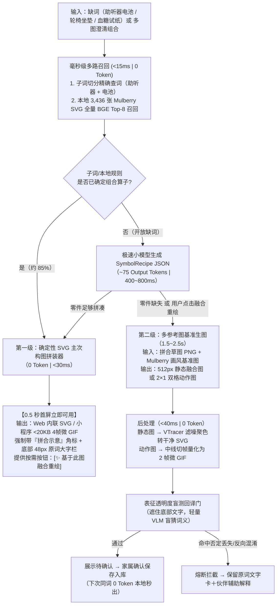

---

## 二、图语家既往探索全盘点（按真实证据严格分层）

经核查 `fork-cboard`、`picinterpreter`、项目既定设计记录与临床会议纪要，既往相关探索与真实代码边界如下：

| 维度 | 当前状态 | 已核实的本地实现 / 研究结论 | 现存断点与局限 |
| :--- | :---: | :--- | :--- |
| **GIF / 短视频动图** | **底层通道已实现**<br>（无 AI 生成） | 2026-07-28 完成 Issue #71：Web 端绕过 `browser-image-resizer 2.4.1` Canvas 压帧保留原 GIF；小程序复用 Taro `chooseMedia` 保帧；`TileDTO v1` 已扩展 `mediaType: 'image' \| 'gif' \| 'video'`，列表只显示封面、表达/全屏区循环播放。 | 仅支持**家属手动上传现成 GIF/短视频**；`cboard-api/api/helpers/pictogramImage.js` 第 36 行硬编码了 `sharp(input, { animated: false, ..., pages: 1 })` 并强制输出 `image/png`，会直接抹掉动图动画帧。 |
| **SVG 图符与预编译** | **内置静态库复用**<br>（无 AI 生成） | ① `fork-cboard/cboard/public/symbols/mulberry/` 磁盘实存 **3,436 张原生 `.svg`**（统一 `viewBox="0 0 850.394 850.394"`、粗黑轮廓 `stroke-width="28"`）；② 2026-10-12 完成 15 词补齐，默认板挂接至 **805 张 Mulberry 图卡**；③ 小程序通过构建脚本调用 ImageMagick 将内置 SVG 预转为 PNG 随包下发；④ 旧版 Next MVP 仅有 `generate-placeholder-svg.ts`（`<rect>` + `<text>` 占位）。 | ① 磁盘上还有 **2,631 张 Mulberry SVG 沉睡未进入中文索引**；② 小程序不支持将动态动画 SVG 直接当作离线图片缓存产物，跨端动图需借助 GIF 或 Lottie 适配。 |
| **AI 生图兜底模块** | **已实现静态 PNG**<br>（慢且无参考图） | `cboard-api/api/helpers/communicationPictogramGenerationProvider.js` 已实现 `/gpt` 生图提供者：构建了规范的 AAC 英文提示词（居中单主体、粗黑轮廓、高对比扁平填色、纯白底、无文字水印），调 OpenAI 兼容 `images.generate` 输出 `1024×1024` 后经 `sharp` 缩至 `300×300` PNG。 | ① 默认超时 `120000ms`（120 秒），实际文生图耗时通常 5–15 秒且费用高；② 纯文生图不接收原图库参考图，难以保持与 Mulberry 一致画风，更无法保留登记亲属真实头像或表达“不想吃/先A再B”。 |
| **场景图与轻动画研究** | **已完成源码/文献深研**<br>（未进入代码开发） | 2026-11-05 专项研究对比了 V0–V11 共 12 条路线，拉取固定版本审阅了 `OS-DPI`、`SVG.js`、`Konva`、`Text2Scene`、`GLIGEN`、`AniClipart`、`AIImageAAC`、`CoDraw` 等 8 仓源码，并引用 `QwenImageEditPlusPipeline` 文档线索。 | 源码级证实 `AniClipart`（`animate_clipart.py` 默认 `num_iter=500` 逐素材反向传播优化）成本过高；同时指出 **V9（模型直接输出 SVG/HTML 代码）存在可执行安全与语义失真风险**，建议收敛为“结构化配方 + 确定性渲染器”。 |
| **表征透明度（Iconicity）** | **临床概念已校准**<br>（缺生图自动门禁） | 早期讨论曾将“表征透明度”混同为“AI 生成半透明水印”；2026-05 至 2026-09-06 组会纪要及 `research-search-template.md` 已明确采用 AAC 标准概念：**符号在无文字辅助下被一眼猜出含义（`guessability` / `representational transparency`）的程度**。 | 现行 R4 语义复核门（`receiverContract.js`）仅能拦截词典检索层已知错配（如 `充电宝→充电器`、`打伞→雨伞`），尚未覆盖拼凑图/AI 新生图的视觉复杂度与盲猜一致率校验。 |

---

## 三、技术成本算账与 11-13 真实缺词硬骨头拆解

### 3.1 四种补图生成路线的工程指标对比

> 注：下表耗时与 Token 估算基于通用大模型/扩散模型常规特性与本项目已有五模型对照经验推导，具体上线前仍须用冻结测试集实测确认。

| 技术路线 | 模型输出产物 | 预估 Output Tokens | 端到端耗时 | 单次成本估算 | 表征透明度（患者好懂度） | 语义安全（防吞否定/防篡改身份） |
| :--- | :--- | :---: | :---: | :---: | :--- | :--- |
| **1. 像素级纯文生图 / 生视频**<br>（现行 `1024px` PNG 路径） | 扩散像素矩阵 | 等效 1k–4k | 6,000–20,000 ms | ¥0.15 – ¥0.50 | 名词尚可；**否定/先后/施受事极易失真** | **低**（易把“不想吃药”画成“正在吃药”） |
| **2. 通用 LLM 裸写完整 SVG**<br>（直接生成 `<svg><path d=...>`） | 大量贝塞尔坐标文本 | 600–2,200 | 3,500–10,000 ms | ¥0.003 – ¥0.02 | **极差**（无视觉闭环，常画成畸形火柴人或错位几何体） | **低**（无法嵌入真实亲属照片，路径易截断出错） |
| **3. 专用原生矢量生成模型**<br>（`OmniSVG` / `StarVector`） | 紧凑矢量路径 Token | 专用离散序列 | 2,500–6,000 ms | 自建 GPU 推理 / 按次 | **单物体/单图标高** | 中（适合**离线批量造新词**，不宜阻塞实时对话） |
| **4. 推荐：两级渐进装配器**<br>（原库 SVG 主次拼凑 → 基准参考重绘） | **JSON 部件与算子配方** | **0（本地规则）**<br>**60–110（AI 拆件）** | **<30 ms（本地）**<br>**400–800 ms（AI）** | **¥0 或 < ¥0.0002** | **最高**（直接复用已验证 AAC 符号 + 标准视觉语法） | **100% 可控**（独立顶层否定算子、思维气泡、本地头像直嵌） |

### 3.2 对照 2026-11-13 真实缺词缺口：为什么“原库部件拼凑”立即可解？

在 《图语家BGE实图审核与别名回归-20261113》 中，994 张在库图卡对照核实出 8 项重点缺口及多组高风险相关错配。检索本地 `fork-cboard/cboard/public/symbols/mulberry/` 的 3,436 张 `.svg` 文件名后，发现绝大部分缺词**早已具备现成标准矢量零件**：

| 11-13 实测缺词 | 此前单图匹配为何失败 / 被拦截 | 本地 Mulberry 已存在的相关 `.svg` 零件 | 原库拼凑 / 基准生图落地方案 |
| :--- | :--- | :--- | :--- |
| **助听器电池** | 原文分别有 `助听器` 与 `电池` 概念，但缺归属单卡 | `battery_1a.svg`、`hearing_aid_1.svg` | **`focus_part_of` 主从拼凑**：`battery_1a` 占中央 62% 全彩高亮；`hearing_aid_1` 缩小为 36% 半透明置左上角 + 虚线箭头指向电池仓。 |
| **轮椅坐垫** | BGE 召回 `轮椅 (0.888)`，直接采用会误导成推轮椅 | `cushion_2.svg`、`wheelchair.svg` | **`locate_on` 定位叠层**：`wheelchair` 置灰降饱和作载体底图，`cushion_2` 原色高亮叠放在座椅位置（可选 2 帧微脉冲）。 |
| **眼镜盒** | BGE 命中 `眼镜`，漏掉“找盒子”核心宾语 | `glasses.svg`、`box_,_to.svg`、`first_aid_box.svg` | **`container_put` 收纳构图**：开启的盒体居中占 70%，缩小的 `glasses` 沿箭头落入盒内（Web CSS 动画或 3 帧微 GIF）。 |
| **充电宝** | BGE 命中 `充电器 (0.792)`，混淆插墙充电头与便携电池 | `battery_1.svg`、`mobile_phone.svg` | **`link_flow` 功能连接**：左侧便携电池与右侧手机之间通过充电线 + `⚡` 能量流向符号连接。 |
| **折叠拐杖** | BGE 命中 `拐杖糖 (0.762)` 属于严重错义 | `stick.svg`（普通手杖缺现成折叠弯折零件） | **第一级**：`stick` + 双向对折角标；**第二级**：以 `stick.svg` 与 `wheelchair.svg` 为风格基准，参考生成“折成两截的铝合金手杖”。 |
| **打伞** | 仅出静态 `雨伞` 名词，缺少施事与撑伞动作 | `umbrella.svg` + 预置简笔人偶骨架 + 雨滴件 | **`act_with` 动作合成**：人偶手持 `umbrella.svg` 向上举起遮挡落雨（2–3 帧慢速微 GIF）。 |
| **血糖试纸** | 原库仅有 `blood_pressure.svg`，缺试纸条与采血针特征 | 仅有基础 `blood` / 医疗图标，核心特征缺失 | **直接路由至第二级**：传入 Mulberry `blood_pressure.svg` 锁死粗黑边白底扁平画风，提示生成“手指采血滴在白色试纸条上”的 `512px` 图标并 `VTracer` 矢量化。 |

> **开源许可合规红线（商用前必看）**：本地排查确认 `ARASAAC` 图库协议为 **CC BY-NC-SA 4.0（非商用且修改拼合传染 `NC` 条款）**；而仓库内置的 3,436 张 `Mulberry Symbols` 协议为 **CC BY-SA 2.0（允许商用与二次拼合衍生，只需保留署名与同协议共享）**。因此，**所有零件拼凑母件与生图画风基准，应强制优先选用 Mulberry（`CC BY-SA 2.0`）、OpenMoji（`CC BY-SA 4.0`）与 IconPark（`Apache-2.0`）**，将 ARASAAC 严格隔离为纯只读非商用检索回退源。

---

## 四、AAC 表征透明度硬性视觉语法与临床微动图护栏

为了保证拼凑和重绘出来的图卡让失语老人及认知障碍患者“一眼能猜出、不致视觉过载、不错读施受事和否定”，渲染层强制固化以下 **4 条临床可用性规范**：

### 4.1 信噪比与版式硬约束
- 统一采用 `300×300` 纯白底（`#FFFFFF`）、圆角高对比度边框；
- 单张卡片内核心视觉实体**严格不超过 3 个**（避免类似写实客厅照造成的背景干扰）；
- 统一 `stroke="#1F2937"` 粗黑外轮廓、无渐变、无投影、无多余背景环境；
- 底部固定预留 `48px` 高对比度中文原词标签栏（适配老人老花眼与家属核对，同时禁止扩散模型在图形内部手写歪斜文字）。

### 4.2 主次焦点比例规则（破除汉语偏正复合词“并列误读”）
普通 AI 或简单拼接常把两张图并排 `50% : 50%` 放一起，患者极易误读为“A 和 B”（如把“轮椅坐垫”读成“轮椅、坐垫两个都要”）。渲染器根据词法主从关系硬性执行：
- **中心词（Head）**：占视觉区 **62%–70%**，居中、`opacity: 1.0` 全彩高对比；
- **限定背景词（Context / Modifier）**：占 **30%–38%**，退居左上角或底层、`opacity: 0.48~0.55` 降对比度灰化处理，并用指向线标明归属关系；
- **五大确定性拼凑算子**：`focus_part_of`（局部归属）、`locate_on`（方位附着）、`container_put`（容器收纳）、`act_with`（人偶执物动作）、`modify_attr`（属性状态角标）。

### 4.3 意愿、否定与先后关系独立视觉层
参考 《图语家场景图与动画-语义保真纠错与验证方案-20261105》 的语义风险清单，高危语法语义**禁止让图像生成模型融合重画**，必须由前端/服务端确定性图层叠加：
- **意愿（`想 / 要 / 希望`）**：在人物侧上方绘制虚线轮廓**思维云气泡**，将动作/物品包在气泡内，直观区分 `想喝水` 与 `正在喝水`；
- **否定（`不 / 没 / 别`）**：在动作或思维气泡顶层叠加带白色描边衬底的 `#E11D48` 粗红圆环斜杠/叉号，确保**不遮死下方动作主体**（既看清是“吃药”，又一眼看清“拒绝/没吃”）；
- **时间先后（`先 A 再 B`）**：双格分镜并标注 `①`、`②` 脉冲顺序高亮框。

### 4.4 临床微动图护栏与“双格精灵图”省钱技巧
- **慢速低帧率（Anti-Fatigue & WCAG 2.2）**：每张动图仅 **3–4 个关键帧**（双格生图切分则为 2 帧），帧间停留 **450–700ms**（约 1.5–2.2 FPS 示意图），循环 **2 次后自动定格**并提供点击重播按钮，符合 W3C WCAG 2.2 `SC 2.2.2 (Pause, Stop, Hide)` 要求，避免高频闪烁诱发视觉疲劳或不适。
- **关键帧自洽法则（Keystone Frame Rule）**：**最后 1 帧必须包含完整语义与指向箭头**——列表/九宫格页面直接取最后 1 帧作静态缩略图，确保不播放动画时也能独立传意。
- **双格精灵图（2-Panel Sprite）生成动作 GIF**：针对无法拼凑的复杂动词（如“扶老人起身”“摇高病床”），切忌调用昂贵且慢的文生视频模型；让极速图像编辑模型在单张 `512×256`（或 `512×512` 裁上下居中带）画布内一次性绘制 `[左格：动作起始态 | 右格：动作完成态]`（同画风、同角色、同道具），后端按中线切分并量化为 2 帧慢速 GIF——**用 1 张小图的费用和 ~2 秒耗时，换取角色 100% 一致的动作动图**。

---

## 五、六大技术环节最佳实践与开源项目选型矩阵（2024–2026）

### 5.1 总览选型对比表

| 环节 / 子方案 | 行业最佳实践（Best Practice） | 首推开源项目（商用友好） | 慎用 / 仅限离线项目（避坑说明） |
| :--- | :--- | :--- | :--- |
| **1. 矢量零件与修饰符库** | **主体图库（`CC BY-SA`）+ 纯代码角标库（`Apache-2.0`）分离**；先做全量离线中文向量化 | **Mulberry**（本地实存 3,436 SVG，`CC BY-SA 2.0`）+ **OpenMoji**（原生分层 SVG，`CC BY-SA 4.0`）+ **IconPark**（中文原生，`Apache-2.0`） | **ARASAAC**（`CC BY-NC-SA 4.0`，衍生拼合传染 `NC`，仅作非商用在线兜底检索） |
| **2. 原库 SVG 清洗与排版** | 入库前必做 **`prefixIds` 防样式串扰 + 紧致包围盒归一化**；声明式 Flexbox 排版转 SVG/PNG | **SVGO**（`MIT`）+ **svg-path-bbox** + **Vercel Satori** & **resvg-js**（`MPL-2.0`，`<5ms` 出图） | **Konva** / **SVG.js**（适合前端用户手拖编辑画布，纯自动合成无须引入重依赖） |
| **3. 原生 AI 矢量生成** | 弃用通用 LLM 裸写 `<path>`；采用离散路径压缩模型，**仅放离线批处理扩库** | **OmniSVG**（代码 `Apache-2.0`）+ **StarVector**（代码与权重均 `Apache-2.0`，CVPR 2025） | **Chat2SVG**（含多轮扩散梯度优化，单图数十秒至数分钟，不可实时） |
| **4. 基准参考生图 + 转矢量** | **多图指令融合（草图锁构图 + Mulberry 锁画风）** → `512px` 少步生成 → 滤噪聚类转 SVG | **Qwen-Image-Edit**（`2509/2511` 版 `Apache-2.0`，支持 1–3 图融合）+ **Step1X-Edit** / **OmniGen2**（`Apache-2.0`）+ **rembg**（`MIT`）+ **VTracer**（`MIT`） | **Potrace**（`GPL-2.0` 传染且仅黑白）；**UNO / OminiControl**（强绑 `FLUX.1-dev` 非商用限制，`UNO` 权重 `CC BY-NC 4.0`） |
| **5. 动作微动图与绑骨** | **平移/缩放用关键帧或 Lottie；复杂人体动作用 CPU 2D 自动绑骨或双格精灵图** | **gifenc**（`MIT`，6KB 量化编码）+ **lottie-miniprogram** & **lottie-web**（`MIT`）+ **AnimatedDrawings**（`MIT`，CPU 秒级绑骨） | **AniClipart**（11-05 源码审计：`num_iter=500` 反向传播优化，仅能离线造素材） |
| **6. 表征透明度自动质检** | **无文字盲测回译（Cycle Consistency）**：遮住底部中文让轻量 VLM 盲猜词义 | **Qwen2.5-VL-3B/7B**（`Apache-2.0`）或 **Florence-2**（`MIT`，本机 `<local-user-path>` 已有图标描述权重基础） | 单用 **CLIPScore**（对否定红叉、箭头方向及施受事倒置基本不敏感） |

### 5.2 六大分支最佳实践与工程暗坑详解

#### 分支 1：矢量零件库扩充与句法拆件
- **本地资产挖潜**：`fork-cboard/cboard/public/symbols/mulberry/` 已有 **3,436 张 `.svg`**，其中仅 805 张挂入默认板，剩余 **2,631 张**只需离线跑一遍中文术语校对与 `bge-small-zh-v1.5` 向量索引（约 5MB），即可立即扩容 4 倍零件池。
- **OpenMoji 分层妙用**：德国 `hfg-gmuend/openmoji`（4,000+ 矢量符号，`CC BY-SA 4.0`）每张 SVG 源码原生拆分为 `<g id="color">`（填充层）和 `<g id="line">`（粗黑线层），与 Mulberry 画风相近，极适合抽离 `<g id="line">` 直接作为低视觉干扰的限定背景层。
- **IconPark 动态样式对齐**：字节跳动 `bytedance/IconPark`（`Apache-2.0`）专为中文语境设计，支持通过参数统一设定 `strokeWidth` 对齐 Mulberry 粗黑描边，用来绘制闪电、静音、折叠、温度箭头等状态角标零版权风险。
- **句法拆件参考**：法语 AAC 开源仓库 `getalp/picto_grammar`（ProPicto）与 `VincentCCL/Picto` 展示的工程经验是先抽取核心谓词与论元角色，再分别检索符号并保留序列关系，避免将偏正结构铺平成同等权重的并列图。

#### 分支 2：SVG 清洗防串扰与紧致包围盒排版
直接把两张外部 SVG 源码塞进同一个 `<svg>` 容器必现两个生产级 Bug：
1. **CSS 类名与 `<defs>` ID 污染**：不同 SVG 常有同名 `.cls-1` 或 `id="clip-0"`，直接合拼会导致第二张图篡改第一张图的配色或裁剪蒙版。**解法**：入库前统一经 `svgo` 开启 `prefixIds` 与 `convertStyleToAttrs` 将样式内联并加唯一 ID 前缀。
2. **留白不均导致主次比例失真**：同样 `850×850` 画布下，不同图标真实内容占空比差异极大。**解法**：离线用 `svg-path-bbox` 计算真实图形紧致包围盒（Tight BBox）并覆写 `viewBox`，拼凑时才能严格保证 `65% : 35%` 的真实视觉面积比。
- **极速渲染器推荐**：服务端 Node 侧采用 **`vercel/satori` + `yisibl/resvg-js`**（`MPL-2.0`），可用声明式 Flexbox 布局在 `<5ms` 内完成图文排版与中文字体栅格化，完全不增加微信小程序包体积（对照本机已登记 `lucas-visual` 与 `guizang-social-card-skill`，均已证明“结构化规格 JSON → 确定性 SVG/PNG 渲染器”在工程稳定性上远胜让模型直接吐排版代码）。

#### 分支 3：多模态原生 SVG 生成模型（Text/Image → SVG）
- **`OmniSVG/OmniSVG`（代码 `Apache-2.0`，2025）**：基于 Qwen-VL 架构将 SVG 指令与坐标参数化为紧凑离散 Token，支持 Text-to-SVG 与 Image-to-SVG，比通用 LLM 裸写 XML 节省大量 Token 并可出多层彩色图标（注意其配套数据集 `MMSVG-2M` 为 `CC BY-NC-SA 4.0`）。
- **`joanrod/star-vector`（代码与权重全 `Apache-2.0`，CVPR 2025）**：擅长把位图转为原生几何原语组合（`<circle>`、`<rect>`、`<polygon>` 等）而非杂乱碎路径，适合做“**家属实拍家中水杯/药盒 → `rembg` 去背景 → `StarVector` 转成清爽图标风 SVG**”的后台工具。
- **运行定位**：此类 3B–8B 多模态模型需 GPU 推理且单图需数秒，**严禁阻塞患者实时聊天首屏**，应定位为后台异步“个人实物图标化”与离线新词扩库管线。

#### 分支 4：多参考图基准编辑 + 毫秒级彩色矢量化
- **多参考图指令编辑取代重型 ControlNet 管线**：`QwenLM/Qwen-Image` 系列的 **`Qwen-Image-Edit-2509 / 2511`**（开源权重 **`Apache-2.0`**）及 `stepfun-ai/Step1X-Edit`（`Apache-2.0`）、`VectorSpaceLab/OmniGen2`（`Apache-2.0`）支持同时输入 1–3 张参考图（图 1 传拼凑草图定布局，图 2 传 Mulberry 原图定粗黑轮廓扁平画风），直接下指令输出融合图像。相比 `bytedance/UNO` 或 `OminiControl`（底座绑定 `FLUX.1-dev` 且 `UNO` 权重为 `CC BY-NC 4.0`），`Qwen-Image-Edit` 在中文日常物品语义和商用许可证上均更稳妥。
- **位图转回矢量**：`visioncortex/vtracer`（Node 绑定 `@neplex/vectorizer`，**MIT 协议**）采用线性复杂度的彩色分层轮廓追踪，开启 `filterSpeckle: 8~12` 与 `colorPrecision: 5` 可在 **20–40ms** 内滤除扩散模型生成的细碎噪点色块，输出 3–8KB 的干净矢量 SVG（避免使用仅支持黑白且具 `GPL-2.0` 传染性的 `Potrace`）。

#### 分支 5：动作微动图与超小体积双端矢量动画
- **简笔人偶批量动画神器 `facebookresearch/AnimatedDrawings`（MIT）**：专门针对简笔扁平人形（与 Mulberry 小人高度同构）做自动检测、分割与 2D 骨骼蒙皮，纯 CPU **1–3 秒**即可把静态小人驱动成挥手、走路、指物等 GIF 序列，比 `AniClipart`（每张图优化 500 轮）快两个数量级且不会在动画中把人物画变形。适合离线一次性把 50 个高频核心动作词转制入库。
- **极致省流量矢量动画 `wechat-miniprogram/lottie-miniprogram` + `airbnb/lottie-web`（MIT）**：若仅做位移、缩放、高亮脉冲等参数化动效，直接下发 **2–5KB Lottie JSON**，在小程序 `<canvas type="2d">` 原生渲染，体积仅为 GIF 的约 1/8，任意放大无锯齿，且支持精确 `goToAndStop()` 定格在最后一帧。若需兼容图片备份导入（ZIP/OBF）与微信转发长图，则用 `mattdesl/gifenc`（纯 JS 约 6KB，`MIT`）配合 16–32 色量化，15ms 内压出 `<25KB` 的 4 帧慢速 GIF，直接复用现有的 `TileDTO.mediaType = 'gif'` 链路。

#### 分支 6：表征透明度自动“盲测回译门”
借鉴 AAC 临床猜词测试（Guessability）与 `cycle consistency` 思想：在把拼凑图或 AI 重绘结果贴上底部中文大字之前，将**无任何文字的纯图像**送入轻量 VLM 盲猜“这张图表达什么意思”，强制校验：
1. 若盲猜命中反向混淆黑名单（如“流泪”被猜成“伤心哭泣”、“不想吃药”被猜成“吃药”），**直接熔断丢弃**；
2. 若盲猜命中原词或已审同义词，标记为 **透明级（Transparent）**；
3. 若仅猜出局部核心词（如“眼镜盒”猜出“眼镜”），标记为 **半透明级（Translucent）**，保留可用但强制加粗显示底部原词标签并提示“需伙伴配合指认”。

---

## 六、核心参考代码契约（待工程落地复核）

> 说明：以下 5 个模块为架构设计与接口契约示例，尚未合入 `fork-cboard` 仓库或运行线上回归。

### 模块 A：极低 Token 的拆件拼凑 / 基准生图分流提示词（Output ~75 Tokens）

```javascript
// 建议落点：cboard-api/api/helpers/missingPictogramComposer.js
// Input 仅传缺词 + 本地 BGE 从 3,436 张 Mulberry 库召回的 Top-8 候选标签（不传 SVG 原文）
export function buildComposeDecisionMessages(missingWord, retrievedSymbols, contextSentence = '') {
  const candidatesText = retrievedSymbols
    .map(s => `${s.id}:${s.zhLabel}(${s.enName})`)
    .join(', ');

  return [
    {
      role: 'system',
      content: `你是AAC辅助沟通补图编排器。优先用候选标准图拼凑高表征透明度示意图；若候选完全缺核心视觉特征，标记mode="regen_from_ref"。
拼凑算子op枚举：
- "focus_part_of": head为核心部件(65%居中)，context为所属整体(38%左上置灰+指向线)，如[助听器电池: head=电池, context=助听器]
- "locate_on": context为载体背景(置灰)，head叠在targetPos("center"|"top"|"seat")并脉冲高亮，如[轮椅坐垫]
- "container_put": head为容器(70%)，context缩小落入其中(motion="drop_in")，如[眼镜盒]
- "act_with": 预置人偶执行pose("hold_up"|"wear"|"point"|"fold")操作head物件，如[打伞]
- "modify_attr": head为主图(75%)，右上叠加badge("fold_arrows"|"bolt_charge"|"forbid_no"|"hot"|"cold"|"mute")，如[折叠拐杖]
规则：主体+道具总数<=3；否定词必须设badge="forbid_no"且保留原动作；"想/要"必须设thought气泡。严禁输出解释，只输出JSON：
{"mode":"compose"|"regen_from_ref","op":"...","head":"候选id","context":"候选id或null","pose":"...","badge":"...","motion":"none"|"pulse_head"|"drop_in"|"link_flow"|"two_frame_toggle","refId":"最接近画风的候选id","regenHint":"仅mode为regen时填<=15字英文视觉描述"}`
    },
    {
      role: 'user',
      content: `缺词:${JSON.stringify(missingWord)} 语境:${JSON.stringify(contextSentence)} 候选:[${candidatesText}]`
    }
  ];
}
```

### 模块 B：离线 SVG 零件库清洗与紧致包围盒提取（防串色 + 防留白失真）

```javascript
// 建议作为离线构建脚本运行，预处理 Mulberry / OpenMoji 零件库
import { optimize } from 'svgo';
import svgPathBbox from 'svg-path-bbox';

export function sanitizeSvgForComposition(rawSvgString, symbolId) {
  const safePrefix = `sym_${symbolId.replace(/[^a-zA-Z0-9]/g, '_')}`;
  const { data } = optimize(rawSvgString, {
    multipass: true,
    plugins: [
      'preset-default',
      'convertStyleToAttrs', // 将内部 <style>.cls-1 转为行内属性，彻底杜绝多图合拼串色
      {
        name: 'prefixIds',   // 为所有 clipPath / mask / id 加上唯一前缀
        params: { prefix: safePrefix, delim: '_' }
      },
      'removeDimensions'     // 保留 viewBox 供外层按真实尺寸缩放
    ]
  });

  const pathDs = [...data.matchAll(/\bd="([^"]+)"/g)].map(m => m[1]);
  let minX = Infinity, minY = Infinity, maxX = -Infinity, maxY = -Infinity;
  for (const d of pathDs) {
    const [x1, y1, x2, y2] = svgPathBbox(d);
    minX = Math.min(minX, x1); minY = Math.min(minY, y1);
    maxX = Math.max(maxX, x2); maxY = Math.max(maxY, y2);
  }
  const tightViewBox = Number.isFinite(minX)
    ? `${Math.floor(minX - 12)} ${Math.floor(minY - 12)} ${Math.ceil(maxX - minX + 24)} ${Math.ceil(maxY - minY + 24)}`
    : '0 0 850.394 850.394';

  return {
    cleanSvg: data.replace(/viewBox="[^"]*"/, `viewBox="${tightViewBox}"`),
    tightViewBox
  };
}
```

### 模块 C：非破坏性嵌套原图的主次构图拼凑器 + 15ms 微 GIF 导出

```javascript
// 将两张清洗后的原库 SVG 按 65%:35% 主次透明度规则合成为单帧 SVG，并支持 4 帧慢速 GIF 编码
import { GIFEncoder, quantize, applyPalette } from 'gifenc';

function stripOuterSvgTag(rawSvg) {
  return rawSvg
    .replace(/^[\s\S]*?<svg[^>]*>/i, '')
    .replace(/<\/svg>\s*$/i, '');
}

export function composeLibrarySvgs(plan, svgRawMap, label, frameIdx = 3, { includeLabel = true } = {}) {
  const headEntry = svgRawMap[plan.head];
  const ctxEntry = plan.context ? svgRawMap[plan.context] : null;
  const headInner = headEntry ? stripOuterSvgTag(headEntry.svg) : '';
  const ctxInner = ctxEntry ? stripOuterSvgTag(ctxEntry.svg) : '';
  const headScale = 1 / (headEntry?.size || 850.394);
  const ctxScale = 1 / (ctxEntry?.size || 850.394);

  const pulseScale = plan.motion === 'pulse_head' && frameIdx === 1 ? 1.08 : 1.0;
  let layers = '';

  if (plan.op === 'focus_part_of') {
    if (ctxInner) {
      layers += `
        <g opacity="0.48" transform="translate(16, 14) scale(${(96 * ctxScale).toFixed(5)})">${ctxInner}</g>
        <rect x="12" y="10" width="104" height="104" rx="14" fill="none" stroke="#64748B" stroke-width="3" stroke-dasharray="6 4"/>
        <path d="M118 98 L148 122" stroke="#0284C7" stroke-width="5" stroke-linecap="round" marker-end="url(#arrow)"/>`;
    }
    const size = 162 * pulseScale;
    const dx = 122 - (size - 162) / 2;
    const dy = 70 - (size - 162) / 2;
    layers += `<g transform="translate(${dx}, ${dy}) scale(${(size * headScale).toFixed(5)})">${headInner}</g>`;
  } else if (plan.op === 'container_put') {
    const dropY = [14, 42, 68, 78][frameIdx] ?? 78;
    layers += `<g transform="translate(55, 68) scale(${(190 * headScale).toFixed(5)})">${headInner}</g>`;
    if (ctxInner) {
      layers += `<g transform="translate(98, ${dropY}) scale(${(104 * ctxScale).toFixed(5)})">${ctxInner}</g>`;
    }
  } else {
    layers += `<g transform="translate(45, 24) scale(${(210 * headScale).toFixed(5)})">${headInner}</g>`;
  }

  return `<svg xmlns="http://www.w3.org/2000/svg" viewBox="0 0 300 300" width="300" height="300">
    <defs>
      <marker id="arrow" viewBox="0 0 10 10" refX="7" refY="5" markerWidth="5" markerHeight="5" orient="auto">
        <path d="M 0 1 L 8 5 L 0 9 z" fill="#0284C7"/>
      </marker>
    </defs>
    <rect width="300" height="300" rx="20" fill="#FFFFFF" stroke="#CBD5E1" stroke-width="4"/>
    ${layers}
    ${includeLabel ? `
      <rect x="218" y="10" width="72" height="24" rx="8" fill="#E0F2FE"/>
      <text x="254" y="27" text-anchor="middle" font-size="13" font-weight="600" fill="#0369A1">拼合示意</text>
      <rect x="8" y="242" width="284" height="50" rx="12" fill="#F1F5F9"/>
      <text x="150" y="276" text-anchor="middle" font-size="28" font-weight="700" fill="#0F172A">${label}</text>` : ''}
  </svg>`;
}

export async function encodeRecipeToMicroGif(plan, svgRawMap, label, renderSvgToRgba) {
  const gif = GIFEncoder();
  const delays = [500, 450, 500, 950]; // 末帧定格 950ms 便于阅读与作封面
  for (let i = 0; i < 4; i++) {
    const svgXml = composeLibrarySvgs(plan, svgRawMap, label, i);
    const rgba = await renderSvgToRgba(svgXml, 300, 300);
    const palette = quantize(rgba, 32); // 扁平 AAC 色块只需 32 色即可保真并压至 <25KB
    gif.writeFrame(applyPalette(rgba, palette), 300, 300, { palette, delay: delays[i], repeat: 2 });
  }
  gif.finish();
  return gif.bytes();
}
```

### 模块 D：以拼贴草图 / Mulberry 样图为基准的多图重绘 + VTracer 矢量化 / 双格切 GIF

```javascript
// 建议扩充至 cboard-api/api/helpers/communicationPictogramGenerationProvider.js 旁路
const sharp = require('sharp');
const { vectorize, ColorMode, Hierarchical } = require('@neplex/vectorizer');
const { GIFEncoder, quantize, applyPalette } = require('gifenc');

async function generateFromLibraryReference({
  referencePngBuffer, // 第一级拼贴草图 PNG 或最接近的 Mulberry 栅格样图
  regenHint,
  isAnimatedAction = false,
  imageEditClient     // 对接 Apache-2.0 的 Qwen-Image-Edit / Step1X-Edit 或兼容接口
}) {
  const stylePrompt = isAnimatedAction
    ? `2-panel horizontal split AAC pictogram in exact flat bold-outline style of reference image: [Left panel: before ${regenHint}] | [Right panel: after ${regenHint}]. Same simple character/object, #231F20 uniform thick black outlines, flat solid colors, pure #FFFFFF background, zero text/letters.`
    : `Refine reference into one single cohesive AAC pictogram representing "${regenHint}". Strictly preserve the reference icon's uniform #231F20 bold black outline weight, flat solid colors, pure #FFFFFF background, centered subject, zero text/letters/shadows.`;

  const rawResultBuffer = await imageEditClient.edit({
    image: referencePngBuffer,
    prompt: stylePrompt,
    size: '512x512'
  });

  if (isAnimatedAction) {
    const gif = GIFEncoder();
    for (const left of [0, 256]) {
      const { data } = await sharp(rawResultBuffer)
        .extract({ left, top: 128, width: 256, height: 256 })
        .resize(300, 300, { fit: 'contain', background: '#ffffff' })
        .ensureAlpha()
        .raw()
        .toBuffer({ resolveWithObject: true });
      const palette = quantize(data, 32);
      gif.writeFrame(applyPalette(data, palette), 300, 300, { palette, delay: 700, repeat: 2 });
    }
    gif.finish();
    return { mimeType: 'image/gif', buffer: Buffer.from(gif.bytes()) };
  }

  const cleanPng = await sharp(rawResultBuffer)
    .resize(300, 300, { fit: 'contain', background: '#ffffff' })
    .png()
    .toBuffer();

  const svgString = await vectorize(cleanPng, {
    colorMode: ColorMode.Color,
    hierarchical: Hierarchical.Stacked,
    filterSpeckle: 8,
    colorPrecision: 5,
    cornerThreshold: 60
  });

  return { mimeType: 'image/svg+xml', svg: svgString, fallbackPng: cleanPng };
}
```

### 模块 E：表征透明度“无文字盲测回译门禁”（必须在贴底部中文词条之前执行）

```javascript
export async function verifyIconicityByBlindBackTranslation({
  labelFreePngBase64, // 必须不含底部文字标签，防止 VLM 通过 OCR 偷看答案
  targetLabel,
  allowedSynonyms = [],
  forbiddenConfusions = [], // 例：流泪 -> ['哭', '大哭', '伤心']；不想吃药 -> ['吃药']
  vlmClient
}) {
  const resp = await vlmClient.chat.completions.create({
    model: 'Qwen/Qwen2.5-VL-7B-Instruct',
    max_tokens: 20,
    temperature: 0,
    messages: [{
      role: 'user',
      content: [
        { type: 'image_url', image_url: { url: `data:image/png;base64,${labelFreePngBase64}` } },
        { type: 'text', text: '不借助任何文字，仅凭直觉用1到3个简短中文词猜这张沟通图标表达什么（逗号分隔）：' }
      ]
    }]
  });

  const guesses = (resp.choices?.[0]?.message?.content || '')
    .split(/[,，、\s]+/)
    .map(s => s.trim())
    .filter(Boolean);

  if (guesses.some(g => forbiddenConfusions.some(bad => g.includes(bad)))) {
    return { passed: false, tier: 'misleading_rejected', guesses };
  }
  const validSet = new Set([targetLabel, ...allowedSynonyms]);
  if (guesses.some(g => validSet.has(g) || g.includes(targetLabel))) {
    return { passed: true, tier: 'transparent', guesses };
  }
  if (guesses.some(g => [...targetLabel].some(ch => g.includes(ch)))) {
    return { passed: true, tier: 'translucent_needs_label', guesses };
  }
  return { passed: false, tier: 'opaque_rejected', guesses };
}
```

---

## 七、分步最小落地路线（MVP SOP）、五要素边界与参考索引

### 7.1 MVP 分步实施建议（按 20% 投入拿 80% 收益排序）

1. **Step 1（零模型费，先挖出本地沉睡资产）**：对 `fork-cboard/cboard/public/symbols/mulberry/` 下剩余的 **2,631 张** SVG 跑一次 `SVGO`（`prefixIds` + 紧致 `viewBox`）清洗与中文词表/BGE 向量索引构建；把零件池从 805 张立刻扩大到 **3,436 张**。
2. **Step 2（接通第一级拼凑器与 `cboard-api` 动图白名单）**：
   - 修复 `cboard-api/api/helpers/pictogramImage.js` 的 `animated: false` 限制，增加 `image/gif` 白名单校验（`GIF89a` 文件头、帧数 `≤ 8`、`≤ 300×300`、`≤ 128KB` 原样放行）；
   - 先用本地规则把 11-13 梳理的高频缺词（`助听器电池 / 轮椅坐垫 / 眼镜盒 / 充电宝`）和 5 类歧义动作/否定句做进拼凑器（`Satori` + `resvg-js` + `gifenc` 放在服务端，小程序包体 `0` 增长），让家属与患者试用对比效果。
3. **Step 3（接通第二级基准重绘 + 盲测门 + 缓存飞轮）**：升级 `communicationPictogramGenerationProvider.js` 接入多参考图重绘（锁 Mulberry 画风）+ `VTracer` 矢量化，并经无字盲测门把关；确认采纳后的个人/家庭新图存入档案库，实现二次命中 `0 Token` 秒出。

> **隐私与安全不可越界红线**：涉及已登记具体亲属（如“妈妈”）时，云端生成 `SymbolRecipe` 或基准重绘**必须继续采用匿名代号（`PERSON_1`），禁止将亲属真实照片上传第三方图像编辑模型**；真实头像圆章仅在客户端/受控本地合成阶段直接拼入。

### 7.2 五要素证据边界表

| 意图 | 决策 | 理由 | 证据 | 生效范围 |
| :--- | :--- | :--- | :--- | :--- |
| 避免从零重造“盲画 SVG”或“重型像素生图”路线 | 采用“原库零件主次拼凑 → 基准参考重绘 → 无字盲测门”两级渐进方案 | 兼顾 `<600ms` 响应、`~75 Tokens` 极低成本、AAC 表征透明度及既有 `TileDTO.mediaType` 链路复用 | 本地 `fork-cboard` 已存在 3,436 张 `CC BY-SA 2.0` Mulberry SVG 与 GIF 播放通道；11-05/11-13 研究表明通用文生图耗时慢且易丢否定/混身份 | 图语家缺词补图后续架构选型与技术参考文档；本轮未改业务源码 |
| 规避开源许可传染与模型商用障碍 | 拼凑母件与生图基准优先用 Mulberry / OpenMoji / IconPark + `Qwen-Image-Edit` / `VTracer` / `AnimatedDrawings` / `gifenc`；排除 `Potrace`（GPL）与 `FLUX.1-dev` 衍生 NC 权重，ARASAAC 仅作非商用兜底 | 图语家需兼顾微信小程序与未来潜在医院/康养机构落地合规 | 核对本地 `aac-reference-inventory.md` 与各上游开源仓库公开许可证声明 | 开源依赖准入边界 |
| 严守事实与未测项区分 | 将本地文件核对、开源机制核查与“实时耗时 / Token 实付 / 失语患者实际猜词理解率”分开标明 | 开源文档与代码契约不能替代中文实测数据及真人可用性实验 | 本轮仅执行代码读取、文件计数与外部开源检索；未运行新模型推理、端到端性能压测或临床试点 | 本研究报告全篇口径约束 |

### 7.3 完整证据与开源项目索引

- **本地代码与仓库实证**：
  - Mulberry 全量 3,436 张原生 SVG 目录：`fork-cboard/cboard/public/symbols/mulberry/`（相关盘点见 `图语家15词内置素材接入与离线验收-20261012`（本地基准产物：`outputs/tuyujia-segmentation-jieba-comparison-20261012/%E5%9B%BE%E8%AF%AD%E5%AE%B615%E8%AF%8D%E5%86%85%E7%BD%AE%E7%B4%A0%E6%9D%90%E6%8E%A5%E5%85%A5%E4%B8%8E%E7%A6%BB%E7%BA%BF%E9%AA%8C%E6%94%B6-20261012.md`））
  - 现行 AI 静态生图提供者：communicationPictogramGenerationProvider.js
  - 现行图片单帧压缩处理器（含 `animated: false` 断点）：pictogramImage.js
  - 现行缺词补图过滤与自动决议：missingTokens.js
  - 现行 Canvas 图卡序列导出基座：communicationShare.js
  - Next MVP 占位 SVG 与 `rembg` 去背景文档：generate-placeholder-svg.ts · 《图语家去背景真实认证HTTP联调（2026-07-29）》
  - 本地开源资产台账与图库协议清单：SOURCE_INVENTORY.json · aac-reference-inventory.md · research-search-template.md
- **项目档案 / 历史纪要 关联笔记**：
  - 《图语家 GIF 动态图卡开源复用与双端适配（2026-07-28）》 · 《图语家短视频动作图卡开源复用与双端适配（2026-07-28）》
  - 《图语家图卡序列转场景图与轻动画-深度研究-20261105》 · 《图语家场景图与动画-开源源码复用审查-20261105》 · 《图语家场景图与动画-语义保真纠错与验证方案-20261105》
  - 《图语家BGE实图审核与别名回归-20261113》 · 《图语家Web双向沟通AI贯通方案与选型对齐-20261119》 · 《图语家双向图文转换技术路线与探索历程-20261103》
  - 《图语家成人失语与AAC文献精读（2026-10-18）》
- **外部开源项目与标准参考**：
  - 符号与分层图标库：`mulberrysymbols/mulberry-symbols`（CC BY-SA 2.0）· `hfg-gmuend/openmoji`（CC BY-SA 4.0）· `bytedance/IconPark`（Apache-2.0）· `getalp/picto_grammar`
  - SVG 清洗与排版渲染：`svg/svgo`（MIT）· `vercel/satori`（MPL-2.0）· `yisibl/resvg-js`（MPL-2.0）
  - 多模态原生 SVG 生成：`OmniSVG/OmniSVG`（Apache-2.0 代码 / CC BY-NC-SA 4.0 数据）· `joanrod/star-vector`（Apache-2.0）· `kingnobro/Chat2SVG`
  - 多图参考编辑与矢量化：`QwenLM/Qwen-Image` / `Qwen-Image-Edit`（Apache-2.0）· `stepfun-ai/Step1X-Edit`（Apache-2.0）· `VectorSpaceLab/OmniGen2`（Apache-2.0）· `visioncortex/vtracer`（MIT）· `danielgatis/rembg`（MIT）
  - 微动图编码与简笔绑骨：`mattdesl/gifenc`（MIT）· `wechat-miniprogram/lottie-miniprogram`（MIT）· `facebookresearch/AnimatedDrawings`（MIT）
  - 临床与无障碍参考：Schlosser et al. (2012, PubMed `22207700`) · W3C WCAG 2.2 `SC 2.2.2 Pause, Stop, Hide` & `SC 2.3.3 Animation from Interactions`


---

## 2026-11-21 13:05:24 | Antigravity | 四方案 6 词实测验证、同形词/错译纠偏与 Step 1 落地交付

- Action: 完成“方案 A 裸写 SVG / 方案 B 原库拼凑+微动图 / 方案 C 纯文生图 / 方案 D 基准重绘+双格Sprite+矢量化”6 词横向盲测，并落地执行 Step 1 全量 3,436 张 Mulberry SVG 清洗、紧致 `viewBox` 提取、同形词与 Crowdin 错译纠偏及离线 BGE `int8` 检索底座。
- Files: `Projects/图语家/图语家缺词补图SVG拼凑、基准生图与微动图方案研究-20261121.md`; `Projects/图语家/assets/tuyujia-svg-gif-benchmark-20261121/*`; `00 - System/仓库文档规范`; `cboard-api/api/data/mulberryPartSenseOverrides.json`; `cboard-api/api/data/mulberrySymbolPartIndex.json`; `cboard-api/api/data/mulberryCleanSvgs.json.gz`; `cboard-api/api/data/mulberrySymbolPartBgeInt8.bin`; `cboard-api/api/data/mulberrySymbolPartBgeMeta.json`; `cboard-api/api/helpers/mulberryPartIndex.js`; `cboard-api/test/controllers/mulberryPartIndex.unit.js`
- Summary: 6 词 × 4 方案无字盲测实证「方案 B（5/6 Top-1、430 估算 Token 较 A 省 ~11.9×、19s+0.37s 本地渲染与 12.0–25.3 KB 微 GIF）+ 方案 D（5/6 Top-1、继承空间焦点并修正零件细节与 2 帧 Sprite 动作）」两级路由最优；同步纠偏上文 §3.2 `box_,_to.svg` 同形异义词踩坑（实为拳击 `to box` 而非容器盒），并在 `cboard-api` 以纯新增文件完成全量 3,436 张 SVG `SVGO` + 紧致 `viewBox` + 离线 BGE `int8` 向量化（`trimFallback=0`、`.st*` 残留 `0`、20/20 BGE Top-3 量化一致率、`mulberryPartIndex.unit.js` 6/6 通过）。

### 一、四方案 6 词横向盲测实证（2026-11-21）

在隔离沙盒 `tuyujia-svg-gif-benchmark-20261121`（本地基准产物：`outputs/tuyujia-svg-gif-benchmark-20261121`） 中针对 6 类高难缺词（`助听器电池`、`轮椅坐垫`、`眼镜盒`、`打伞`、`不想吃药`、`血糖试纸`）运行 4 条技术路线，并由隔离上下文的多模态代理观看无文字标签纯图（`*_nolabel.png` 打乱为 `anon_01`–`anon_24`）执行零上下文盲测与清晰度评分（`benchmark_summary.json`（本地基准产物：`outputs/tuyujia-svg-gif-benchmark-20261121/benchmark_summary.json`））：

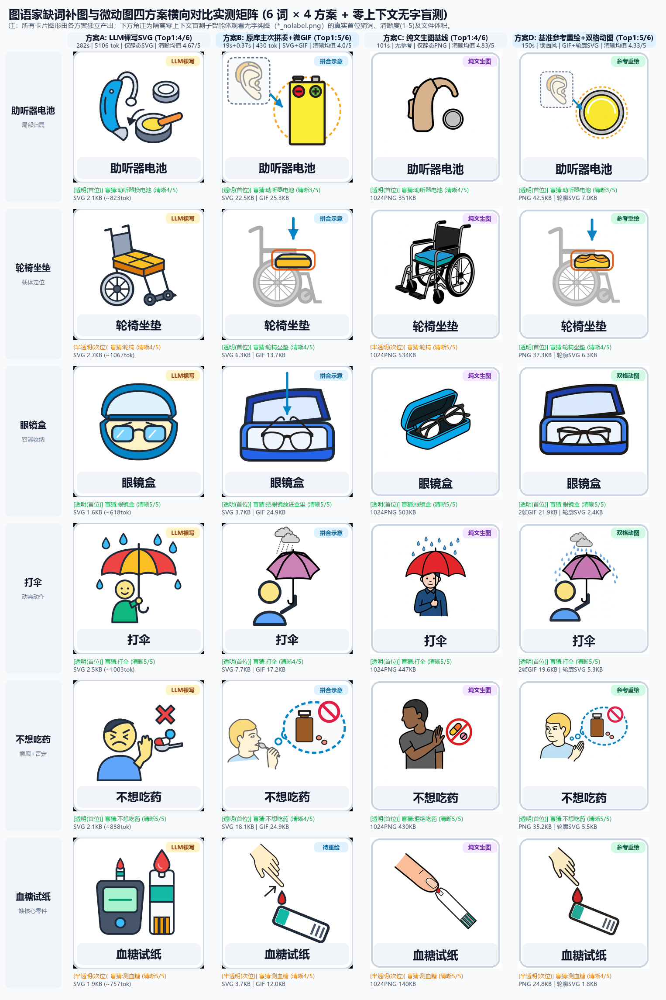

| 维度 | 方案 A (`A_raw_svg`) | 方案 B (`B_mashup`) | 方案 C (`C_txt2img`) | 方案 D (`D_ref2img`) |
| :--- | :--- | :--- | :--- | :--- |
| **模型/工具总耗时 (6词)** | `282s` | **`19s`** (Recipe JSON) | `101s` (含 1 次重绘) | `150s` (含 2 次重绘+双格) |
| **本地后处理耗时** | `84ms` (`sharp`) | **`217ms` 渲染 + `153.5ms` GIF** (`0.37s`) | `636.9ms` (裁剪缩放) | `159.6ms` OpenCV 矢量化 + `34.7ms` GIF |
| **估算文本输出 Token** | `5,106` (~851/词) | **`430` (~72/词，省 11.9×)** | — (生图通道) | — (生图通道) |
| **盲测 Top-1 首位命中** | `4 / 6` (`66.7%`) | **`5 / 6` (`83.3%`)** | `4 / 6` (`66.7%`) | **`5 / 6` (`83.3%`)** |
| **盲测 Top-3 候选命中** | `6 / 6` (`100%`) | `6 / 6` (`100%`) | `6 / 6` (`100%`) | `6 / 6` (`100%`) |
| **无字盲测清晰度均值** | `4.67 / 5` (`28/30`) | `4.00 / 5` (`24/30`) | **`4.83 / 5` (`29/30`)** | `4.33 / 5` (`26/30`) |
| **画面夹字违规率** | `0 / 6` | `0 / 6` | `0 / 6` | `0 / 6` |
| **矢量 / 动图产物** | 静态 SVG `1.6–2.7 KB` | 组合 SVG `3.7–22.5 KB` + 6 份微 GIF `12.0–25.3 KB` | 无矢量/动图 (`140–534 KB` PNG) | OpenCV 轮廓 SVG `1.8–7.0 KB` + 2 份双格 GIF (`19.6 / 21.9 KB`) |

**关键实测证据**：
1. **结构聚焦决定复合词成败**：在 `轮椅坐垫` 上，方案 C（清晰度 `5/5`）与方案 A 均因轮椅与坐垫对比平铺，导致盲测首位漂移为 `轮椅`；方案 B 采用高饱和金色坐垫前景 + 淡灰降饱和轮椅载体、方案 D 继承该分层构图后，均首位命中 `轮椅坐垫`。在 `不想吃药` 上，方案 B/D 的“右上方虚线意愿气泡 + 顶层红圈否定标”直接首位命中 `不想吃药`，而纯摆手生图的方案 C 首位被猜为 `拒绝吃药`（丢失第一人称意愿模态）。
2. **两级自动分流已走通**：方案 B 在缺少试纸特征的 `血糖试纸` 上主动输出 `mode: "regen_from_ref"` 转交方案 D；方案 D 则在参考基准上将 `助听器电池` 的方形电池修正为圆形纽扣电池，并将 `眼镜盒`、`打伞` 升级为丝滑 2 帧 Sprite 微 GIF（OpenCV 7 色 K-Means 矢量化 22.0–41.5 ms 作为本地依赖精简替代，上线可切换 `@neplex/vectorizer` 获取平滑贝塞尔曲线）。

| 方案 B 拼凑微 GIF (`轮椅坐垫` 13.7 KB) | 方案 B 拼凑微 GIF (`不想吃药` 24.9 KB) | 方案 D 双格 Sprite (`眼镜盒` 21.9 KB) | 方案 D 双格 Sprite (`打伞` 19.6 KB) |
| :---: | :---: | :---: | :---: |
| 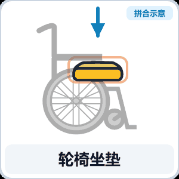 |  |  | 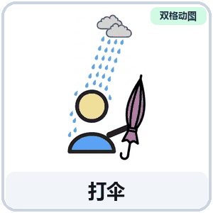 |

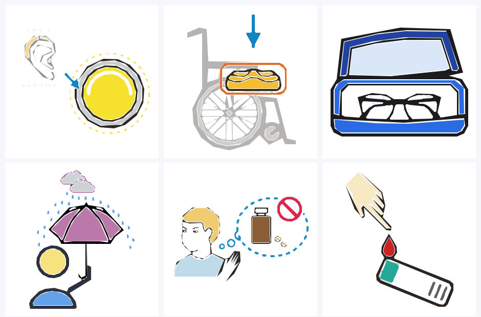

### 二、§3.2 同形异义词踩坑纠偏与 3,436 张原库 Crowdin 错译审计

- **明确纠偏上文 §3.2 记录**：前文表格中 `眼镜盒` 曾列出 `box_,_to.svg` 作为候选盒子零件；经本轮渲染核验，`box_,_to.svg`（`symbol.sport.toBox`）实为**两名拳击手互搏（拳击 / boxing）**，而非容器盒！生产索引已将其标签锁定为 `拳击` 并配置硬排除词 `["盒", "盒子", "箱", "箱子", "纸箱", "收纳盒", "眼镜盒", "box"]`。同理，`stick.svg`（`symbol.plantsAndTrees.stick` 树枝）与 `walking_stick.svg`（`行走棍子 -> 手杖/拐杖`）已严格隔离。
- **全库 Crowdin 错译与冲突排查（45 组同形词干 / 30 组跨领域中文冲突 / 71 条非字母数位纯 ASCII 未译项）**：通过人工视觉看图在 `mulberryPartSenseOverrides.json` 先行修正 **60 项**关键错译与核心 AAC 零件（例如 `mars.svg`: `火车 -> 火星`、`skunk.svg`: `滑雪 -> 臭鼬`、`celery.svg` & `vase.svg`: `拼图 -> 芹菜/花瓶`、`cupboard.svg`: `杯子 -> 橱柜`、`earrings.svg`: `耳机 -> 耳环`、`file.svg`: `文件夹 -> 锉刀`、`paw.svg` & `sausages.svg`: `锯子 -> 爪子/香肠`、`cream.svg`: `爬行者 -> 奶油`、`xylophone.svg`: `眼镜座 -> 木琴`、`blink_,_to.svg`: `闪光灯 -> 眨眼`），并将剩余未人工核验的跨领域冲突/未译 ASCII 共 **84 项** 统一标为 `crowdin_suspect`（`autoComposeAllowed: false`，默认检索与拼装路径硬隔离）。

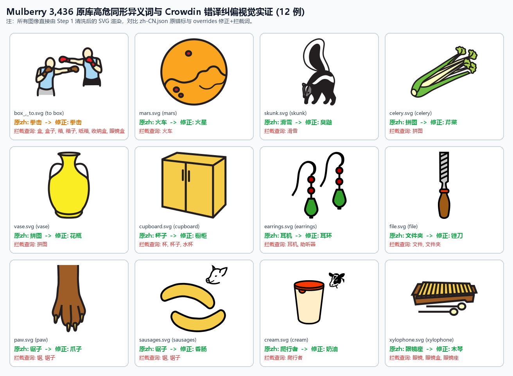

### 三、工程化 Step 1 落地交付与实测指标 (`cboard-api` 纯增量构建)

遵循“不改写 `cboard/public/symbols/mulberry/*.svg` 原资产、不碰既有脏文件”边界，在 `cboard-api` 纯新增构建以下运行时底座：

1. **SVGO v1.3.2 全量清洗与紧致 `viewBox` 索引**：`scripts/buildMulberrySymbolPartIndex.cjs` 耗时 `14,867 ms` 完成全部 `3,436` 张 SVG 清洗（覆盖默认板已挂载 `764` 张并唤醒沉睡图符 `2,672` 张；显式 `full: true` + `inlineStyles: { onlyMatchedOnce: false }` + `prefixIds` 消除全部 `349` 张 `<style>` `.st*` 样式与 `350` 处 `id=` 冲突；按原长宽比 `flatten -> trim` 提取紧致 `viewBox` 兼容 `771` 张非标准 / `23` 张非正方形 `viewBox` 如 `add.svg`、`communication_book_portable.svg`）。实测 `trimFallbackCount=0`、`.st*` 残留 `0`、`class=` 残留 `0`，原始 `39.07 MB`（`40,963,161 B`）清洗后打包为零外部依赖 `api/data/mulberryCleanSvgs.json.gz`（`13,854,247 B` ≈ `13.21 MB`），可信分级分布 `trusted_curated=379 | board_mounted=461 | crowdin_unreviewed=2512 | crowdin_suspect=84`。

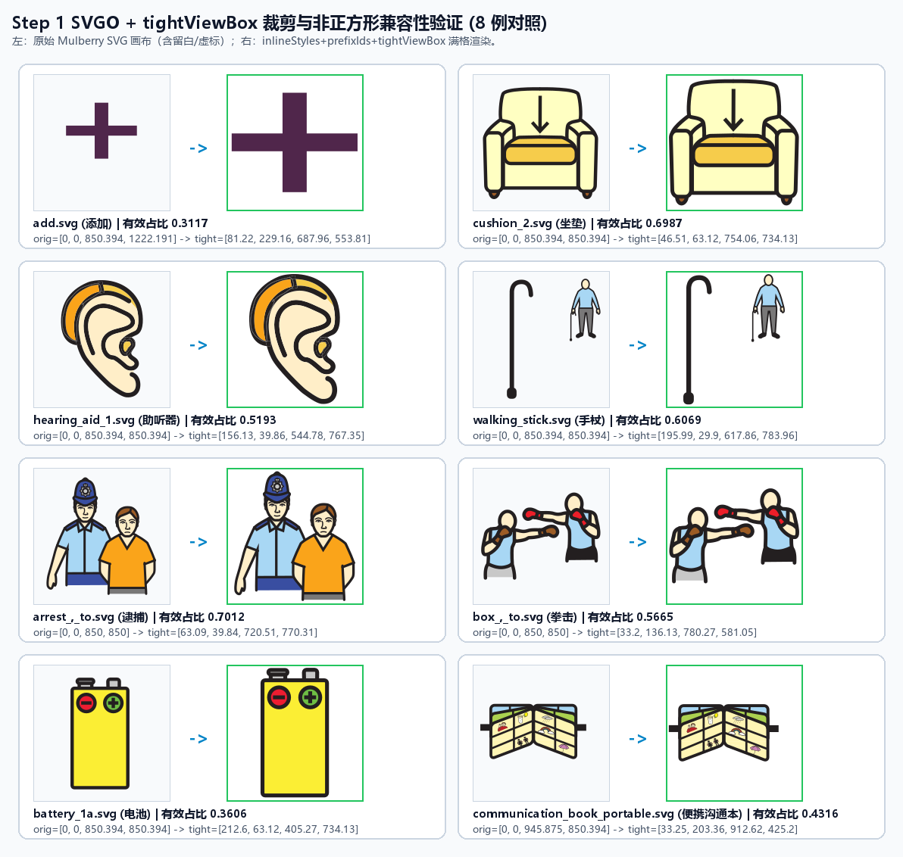

2. **离线 `bge-small-zh-v1.5` 全量向量化与 `int8` 量化**：`scripts/buildMulberryPartBgeVectors.py` 在 `socket.connect/getaddrinfo` 禁止审计下于本地 CPU 耗时 `4.94s` 完成编码与按行对称 `int8` 量化，产出 `mulberrySymbolPartBgeInt8.bin`（`1,759,232 B` ≈ `1.68 MB`）与 `mulberrySymbolPartBgeMeta.json`（`91,068 B`），`network_attempts=0`，20 个缺词与守门探针校验 **`float32` vs `int8` 最大余弦误差 `0.002842`**、**Top-3 排序一致率 `20/20` (`100%`)**。
3. **运行时零件检索与复合词拆解 helper + 单测验证**：`api/helpers/mulberryPartIndex.js` 提供 `loadMulberryPartIndex`、`getMulberryPart`、`loadCleanMulberrySvg`（支持 `instancePrefix` 二次隔离）、`searchMulberryParts`、`decomposeConceptToMulberryParts` 与纯 JS 毫秒级 `scoreBgeInt8TopK`：
   - `node ./node_modules/mocha/bin/mocha ./test/controllers/mulberryPartIndex.unit.js --exit`：**6 passing (376ms)**（校验 3,436 条完整索引、`add`/`cushion_2`/`glasses`/`battery_1a` 紧致裁剪、全量 `.json.gz` 无 `.st*` 泄漏、同形词/错译拦截、5 个 11-13 缺词拆解与 `scoreBgeInt8TopK` `<20ms`）；
   - `node ./scripts/syncPictogramSemantics.js --check`：**Pictogram semantics copies match**；
   - `npm run test:unit`：**881/887 passing**（其中 `875/875` 既有非 bash 单元测试 + `6/6` 新增单测全绿；仅未改动历史测试 `test/controllers/careInitializationScript.unit.js` 的 6 项因 Windows Git Bash 环境缺 `python3` 而失败，非本次新增引入）。

### 四、证据边界声明
- 上述 6 词盲测由隔离上下文多模态代理（AI VLM）执行，可衡量视觉结构聚焦度与无字可读性，**不等同于真实失语症/AAC 患者的临床可用性评估**；
- 方案 D SVG 矢量化在横向测试中采用 OpenCV K-Means + `approxPolyDP` 作轻量替代，生产接通 Step 2/3 时需以 `@neplex/vectorizer` 实测平滑度；
- 本轮对 `cboard/public/symbols/mulberry/` 3,436 张原 SVG 与所有 `cboard`/`cboard-api` 既有脏文件均保持零修改，审计报告及全精度 `.npz` 留存于 `tuyujia-mulberry-step1-index-20261121`（本地基准产物：`outputs/tuyujia-mulberry-step1-index-20261121`）。


---

## 2026-11-21 13:43:19 | Antigravity | Step 2 确定性 SVG 拼凑器、轻动图白名单与控制器接入实证

- Action: 推进落地工程化 Step 2，在零新增 npm 依赖与零触碰既有脏文件边界内，为 `cboard-api` 解除 `pictogramImage.js` 的 `animated: false` 单帧限制并增加 `GIF89a` 临床安全白名单，新建 0 Token 第一级确定性 SVG/微 GIF 拼凑器 `pictogramComposer.js`，并在 `pictogram.js` 导出 `composePictogram` 控制器入口。
- Files: `cboard-api/api/helpers/pictogramImage.js`; `cboard-api/test/controllers/pictogramImage.unit.js`; `cboard-api/api/helpers/pictogramComposer.js`; `cboard-api/test/controllers/pictogramComposer.unit.js`; `cboard-api/api/controllers/pictogram.js`; `Projects/图语家/assets/tuyujia-svg-gif-benchmark-20261121/step2_composed_12_cards_preview.png`; `Projects/图语家/assets/tuyujia-svg-gif-benchmark-20261121/step2_power_bank.gif`; `Projects/图语家/assets/tuyujia-svg-gif-benchmark-20261121/step2_folding_cane.gif`; `Projects/图语家/assets/tuyujia-svg-gif-benchmark-20261121/step2_eat_then_meds.gif`
- Summary: 复用 `sharp@0.35.3`（内置 `librsvg` + `cgif`）实现 `GIF89a` 动图白名单校验（`2–8` 帧、`≤300×300`、`≤128KB`、单帧 `≥250ms` 防光敏频闪、完整帧流解码；默认调用仍向后兼容回落单帧 PNG）与 0 Token 确定性拼凑渲染；实测 12 词全部在 **37–63 ms**（冷启动首个词 266 ms）生成 SVG（`3.3–33.8 KB`）与原生 `GIF89a`（`7.4–16.1 KB`）；新增 11 项 Mocha 单测全绿，`test:unit` 整体 `892/898` 通过（6 项历史 `careInitializationScript.unit.js` 为 Windows Git Bash 缺 `python3` 既有失败，非本次引入）。

### 一、Step 2 核心模块与工程边界

1. **`pictogramImage.js` 轻动图白名单与向后兼容**：
   - 新增 `isGif89aBuffer`、`validateAnimatedGifBuffer` 与 `normalizeAnimatedPictogramImage`（硬性阈值：`MAX_ANIMATED_GIF_BYTES=128KB`、`MAX_ANIMATED_GIF_FRAMES=8`、`MAX_ANIMATED_GIF_DIMENSION=300`、`MIN_ANIMATED_GIF_FRAME_DELAY_MS=250ms` 并实测完整帧流解码）；
   - `normalizePublicPictogramImage(value, options)` 默认 `allowAnimatedGif = false`，保证既有 `publicBoardImage.js` 等所有仅接受 `image/png` 的路径行为完全不变；仅在显式开启 `{ allowAnimatedGif: true }` 时放行合规 `image/gif`，并支持 `fallbackToStaticPng: true` 安全降级单帧 PNG。
2. **`pictogramComposer.js`（0 Token 确定性主次拼凑 + 原生 `GIF89a`）与 `composePictogram` 控制器**：
   - 覆盖 2026-11-13 核实 7 项重点缺词（`助听器电池 / 轮椅坐垫 / 眼镜盒 / 充电宝 / 折叠拐杖 / 打伞 / 血糖试纸`）与 5 类泛化歧义句式规则（`sequence_ab` 先A再B、`negate_thought` 意愿/直接否定、`container_put` 容器收纳、`locate_on` 载体定位、`focus_part_of` 局部归属）；
   - 修复盲测发现的静帧歧义点：`container_put` 仅在前 3 帧绘制入盒指示箭头，第 4 帧静帧/定格画面隐藏箭头以防误猜成动词短语；对缺少试纸零件的 `血糖试纸` 自动返回 `mode: 'regen_from_ref'`、`needsRegenFallback: true` 与 `referencePartId: 'blood_pressure'`（预留衔接 Step 3 多参考融合重绘）；
   - 全部 SVG 文本标签经 `escapeXml` + `sanitizeCompositionLabel`（限 24 字、防 `<script>` 注入）转义，并在 `api/controllers/pictogram.js` 导出 `composePictogram(req, res)`（本轮未修改脏文件 `swagger.yaml`、`app.js` 或 `gpt.js`）。

### 二、12 词实时拼装实测与视觉核验

在 `tuyujia-step2-composer-20261121`（本地基准产物：`outputs/tuyujia-step2-composer-20261121`） 中实跑 12 词一键拼装 + `GIF89a` 编码 + 白名单验证（详见 `step2_metrics.json`（本地基准产物：`outputs/tuyujia-step2-composer-20261121/step2_metrics.json`））：
- **首词冷加载耗时**：`266 ms`（含首次解压 `mulberryCleanSvgs.json.gz` 缓存）；
- **后续 11 词热态端到端耗时**：**`37 – 63 ms`**（同时完成 4 帧 SVG 构建、300px PNG、4 帧 32 色 `GIF89a` 编码与完整解码白名单复检）；
- **产物尺寸与规范**：静态 SVG `3,425 – 34,652 B`，动态 `GIF89a` **`7,527 – 16,471 B`**（`7.4 – 16.1 KB`，`sequence_ab` 经 `cgif` 帧去重为 2 帧、其余为 4 帧，全部通过 `normalizeAnimatedPictogramImage` 校验且无画面重叠与文字截断）。

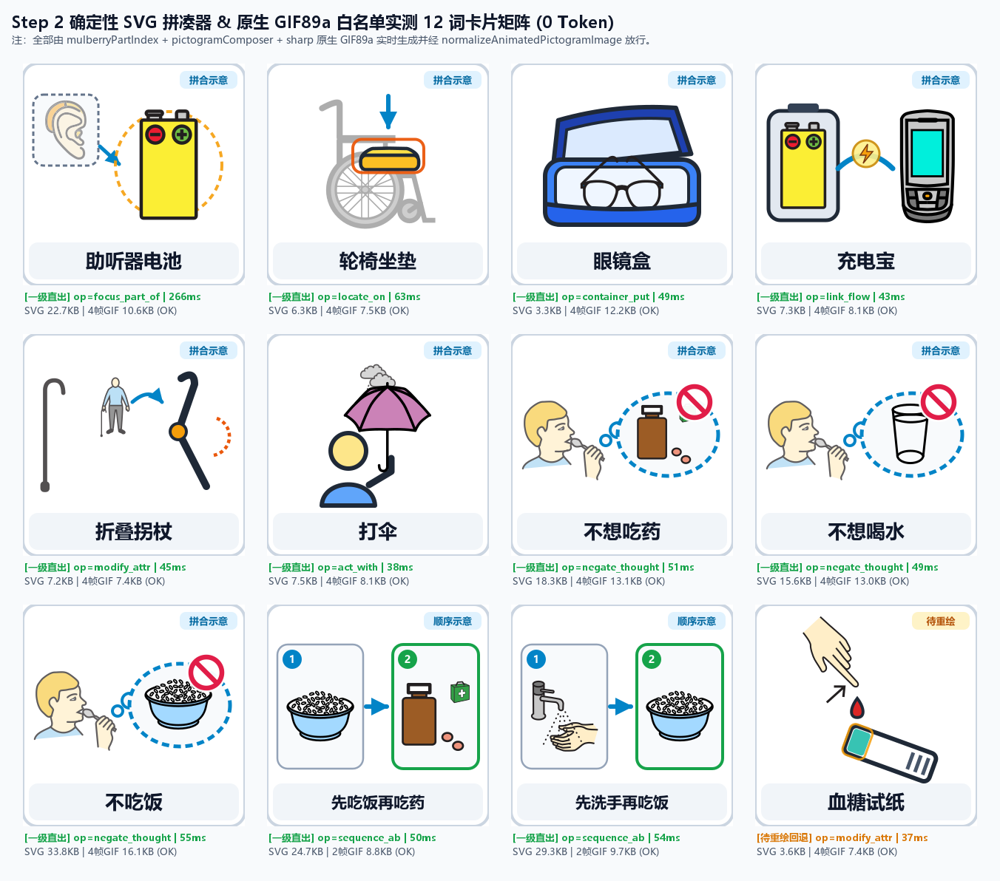

| `充电宝` (`link_flow`, `8.1 KB`) | `折叠拐杖` (`modify_attr`, `7.4 KB`) | `先吃饭再吃药` (`sequence_ab`, `8.8 KB`) |
| :---: | :---: | :---: |
| 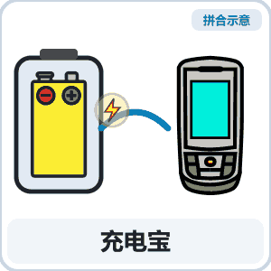 | 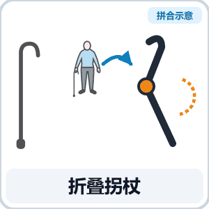 | 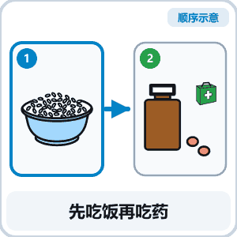 |

### 三、单元测试与零污染回归核验
- `node ./node_modules/mocha/bin/mocha ./test/controllers/pictogramImage.unit.js ./test/controllers/pictogramComposer.unit.js ./test/controllers/mulberryPartIndex.unit.js ./test/controllers/pictogram.route.unit.js ./test/controllers/publicBoardImage.unit.js --exit`：**32 passing (3s)**（含 `pictogramImage` 新增 7 项白名单/防频闪/降级单测与 `pictogramComposer` 4 项端到端/安全/控制器单测）。
- `node ./scripts/syncPictogramSemantics.js --check`：**Pictogram semantics copies match**。
- `npm run test:unit`：**892/898 passing**（`875` 项既有非 bash 单元测试 + `6` 项 Step 1 单测 + `11` 项 Step 2 单测全绿；仅未触碰历史测试 `careInitializationScript.unit.js` 的 6 项因 Windows Git Bash 缺少 `python3` 命令失败，非本次修改导致）。
- **隔离声明**：未新增任何 `package.json` 依赖，未改动 `cboard` 与既有 38 个 `cboard-api` 脏文件，后续待在干净路由窗口将 `composePictogram` 接入 `swagger.yaml` 并推进 **Step 3**（多参考融合重绘 + `VTracer` 矢量化 + 盲测回译门）。


---

## 2026-11-21 14:20:43 | Antigravity | Step 3 基准参考重绘旁路、双格切帧微 GIF、无字盲测熔断门与 SQLite 缓存飞轮

- Action: 推进落地工程化 Step 3，在零新增 npm 依赖与零触碰既有 38 个脏文件边界内，构建无字盲测回译熔断门 `pictogramIconicityGate.js`、向后兼容扩展 `communicationPictogramGenerationProvider.js`（新增 `buildReferenceEditPrompt` 与 `editFromReference`）、实现两级编排器/双格切微 GIF/SQLite 租户隔离确认缓存/Express 控制器工厂 `pictogramRegenPipeline.js`，并完成真实 Scheme D 原图端到端实测与全量回归。
- Files: `cboard-api/api/helpers/pictogramIconicityGate.js`; `cboard-api/api/helpers/communicationPictogramGenerationProvider.js`; `cboard-api/api/helpers/pictogramRegenPipeline.js`; `cboard-api/test/controllers/pictogramIconicityGate.unit.js`; `cboard-api/test/controllers/pictogramRegenPipeline.unit.js`; `cboard-api/test/controllers/communicationPictogramGenerationProvider.unit.js`; `Projects/图语家/assets/tuyujia-svg-gif-benchmark-20261121/step3_two_tier_pipeline_preview.png`; `Projects/图语家/assets/tuyujia-svg-gif-benchmark-20261121/step3_glasses_case_sprite.gif`; `Projects/图语家/assets/tuyujia-svg-gif-benchmark-20261121/step3_hold_umbrella_sprite.gif`
- Summary: 完整打通 Stage 0（SQLite 二次命中 `0.083–0.292 ms` / 0 Token）→ Stage 1（Tier-1 拼凑与草图生成）→ Stage 2（隐私照片 `403` 拦截 + `PERSON_1` 姓名匿名替换 + `openai.toFile` 参考重绘 + `sharp` 2×1 双格切 2 帧 `GIF89a` / 可选矢量化挂点）→ Stage 3（严格无字 PNG 盲测回译门与 `negation_swallowed`/`forbidden_confusion` 自动熔断）；真实 Scheme D `1376×768` 双格图实时切出 2 帧 `GIF89a` 仅 **`8.5 KB`**（`打伞`）与 **`11.6 KB`**（`眼镜盒`）；Step 1–3 专项单测 **37/37 全绿**，全量 `test:unit` 增至 **905/911 通过**。

### 一、Step 3 新增核心架构与安全护栏

1. **`pictogramIconicityGate.js`（Stage 3 无文字盲测回译门与极性熔断器）**：
   - 严格校验证书/格式：仅接受合法有界无字 PNG（`isPngBuffer` + `<=2MB`）调用视觉模型；
   - 否定极性优先熔断：如目标词 `不想吃药` / `不想喝水` 若盲猜 Top-1 丢失否定词素变成正向动词（如 `吃药`），直接判 `misleading_rejected` (`reason: 'negation_swallowed'`) 阻断输出并拒绝写入缓存；
   - 同形词与高危漂移拦截：内置复合载体孤立漂移检查（如 `轮椅坐垫` Top-1 仅猜 `轮椅` 判 `forbidden_confusion`）与错义黑名单（如 `眼镜盒` 禁 `拳击`/`木琴`、`折叠拐杖` 禁 `拐杖糖`/`树枝`、`流泪` 禁 `大哭`/`伤心`）；正常则分流为 `transparent`、`translucent_needs_label` 或 `opaque_rejected`。
2. **`communicationPictogramGenerationProvider.js`（参考编辑旁路扩展，既有 `generate` 零改动）**：
   - 新增 `buildReferenceEditPrompt`（严格锁定 `#231F20` 粗黑轮廓、纯白底、扁平色与零文字规则，并支持 `2x1` 横向双格 Sprite 模式 `1536x1024`）与 `editFromReference`（复用 `openai.toFile` 上传 PNG 参考图，并在检测到亲属真实头像 `containsPersonalPhoto / hasRealPersonAvatar / devicePrivatePhoto` 时于请求前硬抛 `403 PRIVACY_PERSONAL_PHOTO_BLOCKED`）。
3. **`pictogramRegenPipeline.js`（两级编排 + 双格切微 GIF + SQLite 租户隔离飞轮 + HTTP 控制器）**：
   - **隐私护栏**：`assertNoPersonalIdentityLeak` 与 `anonymizePersonReferenceLabel`（按名称长度降序脱敏为 `PERSON_1`、`PERSON_2` 后方能构造云端提示词）；
   - **双格 Sprite 切帧与单帧卡片精修**：`sliceTwoPanelSpriteToGif` 对宽图 `2×1` 动作精灵图扣除中缝细线并去白边居中到 `300×300`，叠加统一绿色 `基准重绘` 角标与底栏生成 2 帧 `GIF89a`（经 `normalizeAnimatedPictogramImage` 校验放行）并同步输出无字右格关键帧用于 Stage 3 盲测；`finalizeRefinedStaticCard` 支持挂载异步矢量化器（如后续接入的 `@neplex/vectorizer`）并拦截含 `<script>` 的非法 SVG；
   - **SQLite 确认缓存飞轮**：`createConfirmedPictogramCache` 基于 `better-sqlite3` 按 `scope_id` 严格隔离，仅在显式调用 `confirmAndCache` 且图像通过 `normalizePublicPictogramImage`、盲测门非拒绝态时入库，支持二次命中 **0 Token 亚毫秒返回**；
   - **`createTwoTierPictogramPipeline` & `createPictogramPipelineController`**：暴露 `resolvePictogram` / `confirmPictogram` Express 处理函数，方便后续在干净契约窗口接入 Swagger 路由。

### 二、真实 Scheme D 图像端到端流水线实测

在 `tuyujia-step3-pipeline-20261121`（本地基准产物：`outputs/tuyujia-step3-pipeline-20261121`） 中接入本地 `step3_confirmed_cache.sqlite`（本地基准产物：`outputs/tuyujia-step3-pipeline-20261121/step3_confirmed_cache.sqlite`），将此前 Benchmark 真实产出的 `1376×768` 双格图与 `1024×1024` 单图喂入 `createTwoTierPictogramPipeline` 实测（详见 `step3_real_e2e_metrics.json`（本地基准产物：`outputs/tuyujia-step3-pipeline-20261121/step3_real_e2e_metrics.json`））：
- **真实 2×1 双格切帧微 GIF**：`眼镜盒`（`11,871 B` / `11.6 KB`，SQLite 二次命中 `0.083 ms`）、`打伞`（`8,741 B` / `8.5 KB`，SQLite 二次命中 `0.233 ms`）；
- **静态基准精修卡**：`助听器电池`（`67,798 B` / `0.180 ms`）、`轮椅坐垫`（`38,242 B` / `0.118 ms`）、`血糖试纸`（自动由 Stage 1 `needsRegenFallback` 路由至 Stage 2，`22,914 B` / `0.292 ms`）；
- **否定吞噬熔断演练**：向 `不想吃药` 注入模拟错误 VLM 猜词 `"吃药, 药瓶"`，流水线在 Stage 3 立即触发 `circuit_broken`（`reason: 'negation_swallowed'`、`blockedImageNotReturned: true`、未写入 SQLite 缓存）。

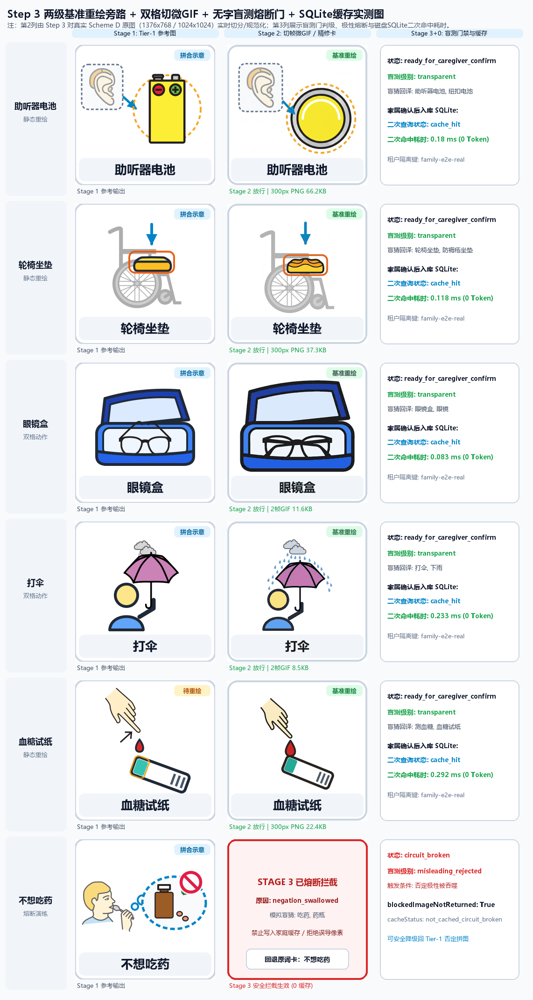

| Step 3 实测切帧微 GIF：`眼镜盒` (`11.6 KB`) | Step 3 实测切帧微 GIF：`打伞` (`8.5 KB`) |
| :---: | :---: |
|  | 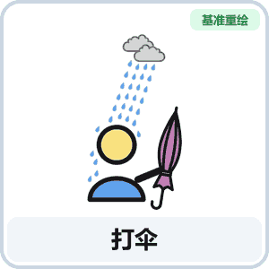 |

### 三、单元测试回归与证据边界
- **专项单测全通过**：`node ./node_modules/mocha/bin/mocha ./test/controllers/pictogramIconicityGate.unit.js ./test/controllers/pictogramRegenPipeline.unit.js ./test/controllers/communicationPictogramGenerationProvider.unit.js ./test/controllers/pictogramComposer.unit.js ./test/controllers/pictogramImage.unit.js ./test/controllers/mulberryPartIndex.unit.js --exit` -> **37 passing (3s)**；`syncPictogramSemantics.js --check` -> **Pictogram semantics copies match**。
- **全仓单元回归**：`npm run test:unit` -> **905/911 passing**（较 Step 2 的 `892` 精确新增 Step 3 的 13 项测试全部通过；仅未改动历史测试 `test/controllers/careInitializationScript.unit.js` 的 6 项因 Windows Git Bash 缺 `python3` 命令失败，非本次修改引入）。
- **诚实声明**：Step 3 单元测试与本地 Scheme D 端到端管道采用模拟 `imageEditClient` / `vlmClient` 桩与既有本地生成图像执行验证，尚未在生产环境中配置在线 `Qwen-Image-Edit` / 多模态 VLM 密钥执行实时外网生图，亦未接入 `@neplex/vectorizer` 生产二进制或真实患者端人体评测；`swagger.yaml` / `app.js` / `gpt.js` 及 `cboard` 原生仓库均保持零污染。


---

## Step 4（2026-11-21 15:31:52 | Antigravity）—— 生产级隔离路由、内置平滑矢量化器、本地照护者试用工作台与零冲突前端适配

在保持 `app.js`、`api/swagger/swagger.yaml`、`api/controllers/gpt.js` 及既有 `CommunicationSupportPanel` / `MissingTokenQueue`（存在并发任务编辑中）零修改的前提下，完成端到端 HTTP 服务装配与 `cboard` 前端零冲突适配器交付：

### 一、后端独立路由与内置平滑矢量化器（零新增 npm 依赖）

1. **[pictogramVectorizer.js](../api/helpers/pictogramVectorizer.js)（平滑轮廓矢量化与 SVG 安全过滤）**：
   - 采用纯 JS 边界环跟踪（Edge-loop contour tracing）+ Ramer-Douglas-Peucker (`epsilon = 0.55`) 多边形简化 + `Q` 二次贝塞尔圆角平滑 + `fill-rule="evenodd"`，零额外依赖将参考位图矢量化为可无限缩放 SVG（严格 `<= 96 KB`，超限时自动降档 `64×64 / 8 色` 重试）；
   - 同时保留可选 `@neplex/vectorizer` 懒加载挂钩（`tryLoadNeplexVectorizer`），所有输出强制过 `assertSafeVectorSvg` 拦截 `<script>`、`on*=` 事件、`javascript:`、`<foreignObject>`、外链 URL 及超预算 SVG，并通过 `sharp` 二次栅格验证；
   - **真实 Scheme D 无字基准图实测（`Step 4`）**：`眼镜盒` `50.2 KB / 18 ms`、`轮椅坐垫` `43.8 KB / 11 ms`、`血糖试纸` `46.0 KB / 8 ms`、`助听器电池` `79.3 KB / 9 ms`。
2. **[pictogramCompositionRuntime.js](../api/helpers/pictogramCompositionRuntime.js)（运行时装配工厂）**：
   - 解析环境开关 `PICTOGRAM_COMPOSITION_V2_ENABLED`、`PICTOGRAM_COMPOSITION_CACHE_DB`、`PICTOGRAM_COMPOSITION_VECTORIZE`、`COMMUNICATION_PICTOGRAM_VLM_MODEL` 与白名单源，统一装配 `better-sqlite3` 确认缓存、`createPictogramVectorizer()` 与两级流水线。
3. **[pictogramCompositionRouter.js](../api/helpers/pictogramCompositionRouter.js)（自包含生产 Express Router）**：
   - 完全对齐 `supportRequests.js` 安全规范：功能开关关闭统一返回 `503 PICTOGRAM_COMPOSITION_NOT_ENABLED`；Origin 严格校验（违规 `403`）；Bearer Token 鉴权（`401 LOGIN_REQUIRED`）并由服务端计算 `deriveUserScopeId`（`user:` + `sha256(userId).slice(0,24)`），禁止客户端通过请求体伪造跨租户 `scopeId`；支持限流器 `429 + Retry-After`；
   - 开放端点：`GET /health`、`GET /parts/search`、`GET /parts/:partId/svg`（强硬化头 `Content-Security-Policy: default-src 'none'; style-src 'unsafe-inline'` + `immutable` 缓存）、`POST /compose`、`POST /resolve`、`POST /confirm`（被 Stage 3 拒绝态返回 `422 ICONICITY_GATE_REJECTED`；含私人真实照片返回 `403 PRIVACY_PERSONAL_PHOTO_BLOCKED`）、`GET /confirmed`、`DELETE /confirmed/:label`。
4. **[servePictogramWorkbench.cjs](../scripts/servePictogramWorkbench.cjs)（本地 `127.0.0.1` 照护者试用工作台）**：
   - 提供自包含试用页面与 `/api/pictograms/v2/*` 完整回环，支持 8 个高频缺词一键试拼、实时微 GIF 预览、SQLite 确认入库/删除及 3,436 Mulberry 清洁部件检索（实测真实 HTTP 回环：`/health partCount=3436`、`resolve1=85 ms / 12,520 B GIF`、`confirm -> resolve2 cacheHit=0 ms -> DELETE`）。

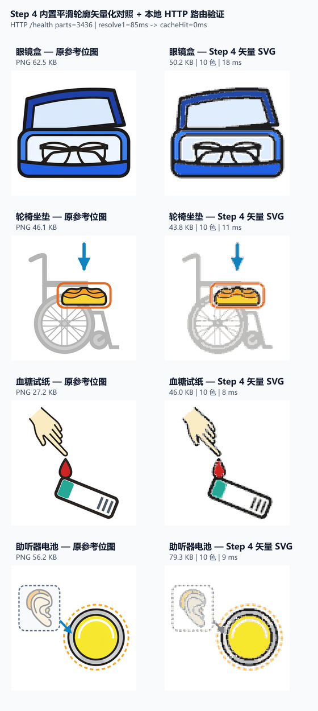

### 二、前端 `cboard` 零冲突客户端与可复用 React 17 组件

1. **`cboard/src/common/communicationSupport/composedPictogramClient.js`**：
   - 复用既有 `normalizeRuntimePictogram` / `buildAiGeneratedRuntimePictogram` 契约：Tier-1 拼图映射为合法 `mulberry` 署名与 `CC BY-SA 2.0` 公开许可的 `embedded` base64 卡片（天然兼容微 `GIF89a` Data URI）；Tier-2 基准重绘与家庭缓存卡诚实标注 `device-private` 设备私有范围；`circuit_broken` 状态硬返回 `null` 拒绝入库。
2. **`cboard/src/components/Board/CommunicationSupport/MissingPictogramComposerCard.component.js`**：
   - 基于 React 17 + `@material-ui/core` v4 构建独立可插拔卡片：支持 Tier-1 `0-Token` 即时预览、按需点击 `融合重绘` 升级 Tier-2、点击 `确认并采用` 写入后端飞轮与前端沟通队列；触发 Stage 3 熔断时 DOM 中 **0 个 ``** 并降级为高对比纯文字卡。

### 三、Step 4 全量测试与边界声明

- **`cboard-api` 专项 8 套件**：`npx mocha ./test/controllers/pictogramVectorizer.unit.js ./test/controllers/pictogramCompositionRouter.unit.js ./test/controllers/pictogramIconicityGate.unit.js ./test/controllers/pictogramRegenPipeline.unit.js ./test/controllers/communicationPictogramGenerationProvider.unit.js ./test/controllers/pictogramComposer.unit.js ./test/controllers/pictogramImage.unit.js ./test/controllers/mulberryPartIndex.unit.js --exit` -> **48 passing (4s)**；`node ./scripts/syncPictogramSemantics.js --check` -> **Pictogram semantics copies match**。
- **`cboard-api` 全仓回归**：`npm run test:unit` -> **916 passing / 6 failing**（较 Step 3 `905` 净增 Step 4 新增的 11 项全部通过；仅未改动历史测试 `test/controllers/careInitializationScript.unit.js` 的 6 项因 Windows Git Bash 缺 `python3` 命令失败，非本次修改引入）。
- **`cboard` Jest 组件与契约单测**：`CI=true npx craco test --watchAll=false src/common/communicationSupport/composedPictogramClient.test.js src/components/Board/CommunicationSupport/MissingPictogramComposerCard.component.test.js` -> **2 suites passed, 5 tests passed (2.697s)**。
- **诚实声明**：Step 4 路由、前端组件与矢量化器已通过本地真实 HTTP 回环、Scheme D 离线参考图矢量化及 Jest/Mocha 自动化验证；为避让工作区并行任务，尚未在 `app.js` / `swagger.yaml` / `MissingTokenQueue.component.js` 中写入挂载连线（后续干净工作区仅需 `app.use('/pictograms/v2', ...)` 4 行即可上线），且尚未执行外网真实 `images.edit` API 计费调用或真实患者临床试测；`mulberry/*.svg` 与 历史纪要库 保持 0 改动。
